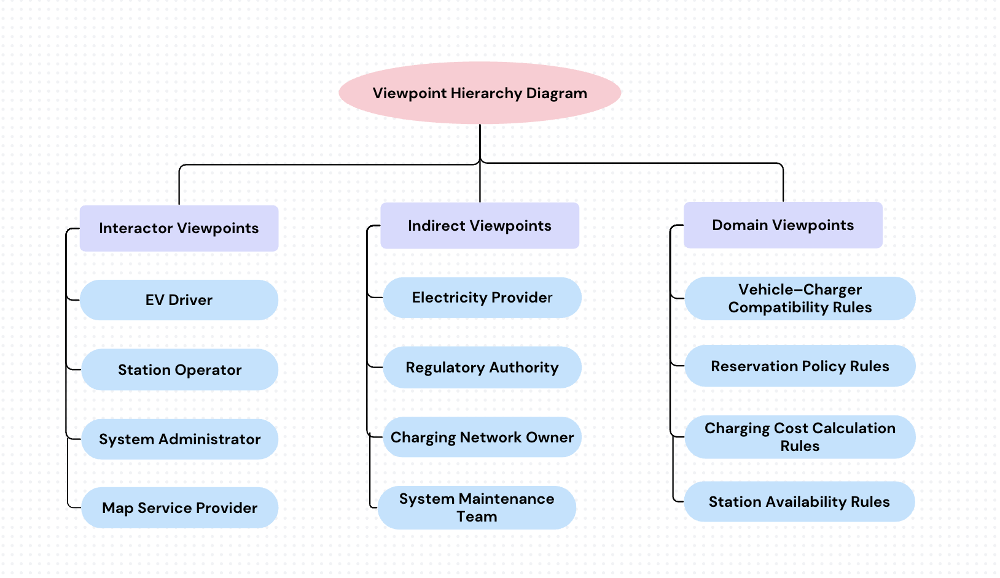
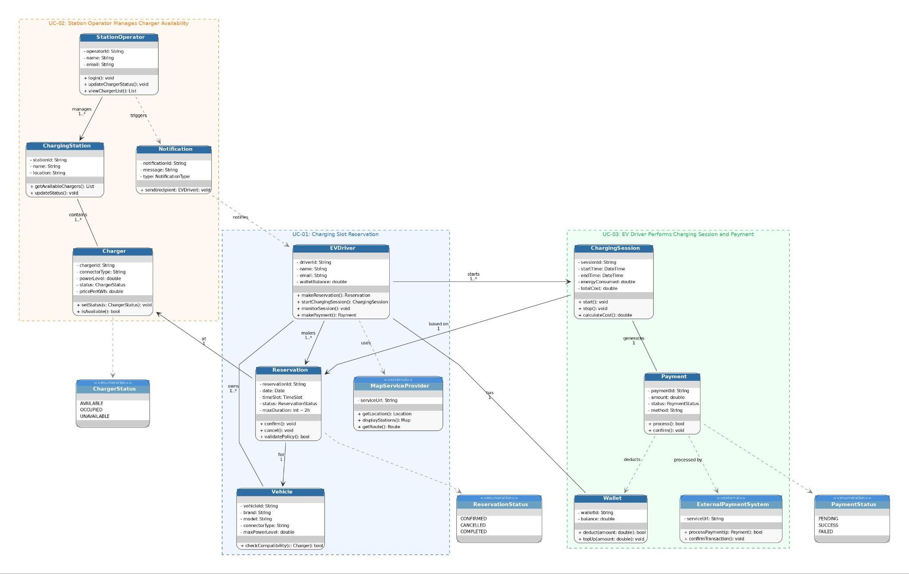

# Requirements Engineering Report

**EV Charging Station Network & Management System**
Fundamentals of Software Engineering, Ege University Computer Engineering, 2025–2026 Spring (Group 3)

This document covers the requirements analysis phase of the project: stakeholder viewpoints, functional / non-functional / domain requirements, MoSCoW prioritization, conflict resolution, the main use cases, and the domain model. The last section maps the requirements to the code in this repository.

## Contents

1. [Introduction](#1-introduction)
2. [Viewpoints](#2-viewpoints)
3. [Requirements Definition, Classification and Prioritization](#3-requirements-definition-classification-and-prioritization)
4. [Requirements Negotiation and Conflict Resolution](#4-requirements-negotiation-and-conflict-resolution)
5. [Use Cases of the Main Scenarios](#5-use-cases-of-the-main-scenarios)
6. [Domain Model](#6-domain-model)
7. [Traceability to the Implementation](#7-traceability-to-the-implementation)
8. [Conclusion](#8-conclusion)

## 1. Introduction

The growing adoption of electric vehicles (EVs) creates demand for efficient charging infrastructure and management systems. Without them, drivers struggle to find available chargers, plan charging sessions, or access accurate station information.

The EV Charging Station Network Management System is a centralized platform where EV drivers register their vehicles, find nearby stations on an interactive map, check charger compatibility, reserve charging slots, monitor sessions, and pay based on energy consumption. Station operators and system administrators use it to manage charging infrastructure, monitor charger availability, and analyze usage.

## 2. Viewpoints

A viewpoint represents the perspective of a stakeholder or a domain rule that shapes the requirements. A viewpoint-oriented approach captures requirements from multiple perspectives so that the analysis is complete and well structured. The principal viewpoints are the **EV Driver**, **Station Operator**, and **System Administrator**.

| Category   | Viewpoint                           | Description |
| ---------- | ----------------------------------- | ----------- |
| Interactor | EV Driver                           | Primary user. Finds stations, registers vehicles, makes reservations, monitors charging sessions, and pays. |
| Interactor | Station Operator                    | Updates station and charger information (type, connector, pricing), monitors availability, handles maintenance and technical issues, reviews utilization. |
| Interactor | System Administrator                | Supervises and configures the system: users and permissions, performance monitoring, reports, logs, security. |
| Interactor | Map Service Provider                | Supplies mapping services for station discovery, route visualization, and distance calculation. |
| Indirect   | Electricity Provider                | Supplies energy; interested in consumption data, peak demand, and grid load balancing. |
| Indirect   | Regulatory Authority                | Ensures legal and safety compliance, pricing transparency, and data protection. |
| Indirect   | Charging Network Owner              | Tracks revenue, utilization and peak demand; plans expansion and pricing strategy. |
| Indirect   | System Maintenance Team             | Keeps the system available, monitors faults, performs updates. |
| Domain     | Vehicle–Charger Compatibility Rules | Connector type and power level compatibility; blocks unsafe or incompatible reservations. |
| Domain     | Reservation Policy Rules            | Session duration limits, double-booking prevention, advance-booking limits, auto-cancellation. |
| Domain     | Charging Cost Calculation Rules     | Cost from consumed energy and station price, wallet deduction, digital receipts. |
| Domain     | Station Availability Rules          | When chargers are available, occupied, or unavailable (maintenance, reservations, failures). |

## 3. Requirements Definition, Classification and Prioritization

**Type:** FR = functional, NFR = non-functional, DR = domain requirement.
**Lifetime:** Enduring = stable over the system's life, Volatile = likely to change.
**Priority (MoSCoW):** Must / Should / Could / Won't.

| ID     | Viewpoint               | Type | Requirement | Lifetime | Priority |
| ------ | ----------------------- | ---- | ----------- | -------- | -------- |
| REQ-01 | EV Driver               | FR   | The system shall allow EV drivers to create an account using an email address and password. | Enduring | Must |
| REQ-02 | EV Driver               | FR   | The system shall ensure that users log in to the platform securely. | Enduring | Must |
| REQ-03 | EV Driver               | FR   | The system shall allow EV drivers to register electric vehicles including brand, model, battery capacity, connector type, and plate number. | Enduring | Must |
| REQ-04 | EV Driver               | FR   | The system shall display nearby charging stations on an interactive map based on the user's current location. | Enduring | Must |
| REQ-05 | EV Driver               | FR   | The system shall display charging stations on the map with color codes indicating availability (Green: Available, Yellow: Occupied, Red: Offline). | Enduring | Must |
| REQ-06 | EV Driver               | FR   | The system shall allow EV drivers to filter charging stations on the map by connector type. | Enduring | Should |
| REQ-07 | EV Driver               | FR   | The system shall allow EV drivers to filter charging stations by power output or pricing information. | Enduring | Should |
| REQ-08 | EV Driver               | FR   | The system shall allow EV drivers to select a charging station and a specific charger from the map interface. | Enduring | Must |
| REQ-09 | EV Driver               | FR   | The system shall allow EV drivers to create reservations for a selected charger, date, and time slot. | Enduring | Must |
| REQ-10 | EV Driver               | FR   | The system shall allow the user to cancel their existing reservations. | Enduring | Should |
| REQ-11 | EV Driver               | FR   | The system shall provide navigation directions from the user's location to the selected charging station. | Enduring | Should |
| REQ-12 | EV Driver               | FR   | The system shall allow EV drivers to monitor active charging sessions including current energy consumption and estimated completion time. | Volatile | Must |
| REQ-13 | EV Driver               | FR   | The system shall allow the driver to stop the active charging process remotely via a command. | Enduring | Should |
| REQ-14 | EV Driver               | FR   | The system shall display charging session summaries including consumed energy and total charging cost. | Enduring | Should |
| REQ-15 | EV Driver               | FR   | The system shall allow users to save favorite stations for quick access. | Enduring | Could |
| REQ-16 | EV Driver               | FR   | The system shall integrate a secure payment gateway for wallet top-ups. | Volatile | Could |
| REQ-17 | EV Driver               | FR   | The system shall send alerts for reservation confirmations, charging started/completed, and low wallet balance. | Volatile | Should |
| REQ-18 | Station Operator        | FR   | The system shall allow station operators to log in to their own management panels. | Enduring | Must |
| REQ-19 | Station Operator        | FR   | The system shall allow station operators to update charger availability status (available, occupied, offline). | Enduring | Should |
| REQ-20 | Station Operator        | FR   | The system shall allow station operators to mark chargers as unavailable due to maintenance or technical issues. | Enduring | Should |
| REQ-21 | Station Operator        | FR   | The system shall allow station operators to update the pricing per kWh for their own stations. | Enduring | Should |
| REQ-22 | Station Operator        | FR   | The system shall allow station operators to review charging sessions and analyze station utilization statistics. | Volatile | Should |
| REQ-23 | System Administrator    | FR   | The system shall allow system administrators to manage system users including EV drivers and station operators. | Enduring | Could |
| REQ-24 | System Administrator    | FR   | The system shall generate system reports including revenue statistics and station utilization information. | Volatile | Should |
| REQ-25 | System Administrator    | FR   | The system shall allow system administrators to register new charging stations and operators into the platform. | Enduring | Must |
| REQ-26 | System Administrator    | FR   | The system shall maintain audit logs of all transactions to ensure system security and reliability. | Enduring | Could |
| REQ-27 | Map Service Provider    | FR   | The system shall integrate Google Maps API (or equivalent) to display stations on an interactive map and enable route visualization. | Volatile | Should |
| REQ-28 | Map Service Provider    | FR   | The system shall calculate the distance from the user to each charging station. | Enduring | Should |
| REQ-29 | Electricity Provider    | FR   | The system shall provide aggregated electricity consumption data for charging stations. | Volatile | Could |
| REQ-30 | Electricity Provider    | FR   | The system shall analyze peak charging demand to support grid load balancing for electricity providers. | Volatile | Could |
| REQ-31 | System Maintenance Team | NFR  | [Availability] The system shall maintain a high availability of 99.99% to ensure continuous operation. | Enduring | Should |
| REQ-32 | Regulatory Authority    | NFR  | [Security] The system shall ensure compliance with electrical safety and data protection regulations (e.g., GDPR) by using secure payment gateways and data encryption. | Enduring | Could |
| REQ-33 | Network Owner           | FR   | The system shall provide the charging network owner with revenue reports and ROI analyses of the stations. | Volatile | Could |
| REQ-34 | Network Owner           | FR   | The system shall provide charging station utilization statistics and peak usage analysis. | Volatile | Could |
| REQ-35 | System Maintenance Team | FR   | The system shall allow the maintenance team to monitor system faults and view station issues (e.g., damaged connector, broken payment terminal). | Enduring | Should |
| REQ-36 | System Maintenance Team | FR   | The system shall automatically generate error logs for hardware failures and forward them to the maintenance team. | Enduring | Should |
| REQ-37 | System Maintenance Team | FR   | The system shall allow the maintenance team to perform remote software updates on supported chargers. | Volatile | Could |
| REQ-38 | Compatibility Rules     | DR   | The system shall validate compatibility between vehicle connector types and charger connector types before creating a reservation. | Enduring | Must |
| REQ-39 | Compatibility Rules     | DR   | The system shall verify that the charger power level is supported by the selected vehicle. | Enduring | Must |
| REQ-40 | Compatibility Rules     | DR   | The system shall prevent reservations when safety or compatibility conditions are not satisfied and display a warning message. | Enduring | Must |
| REQ-41 | Reservation Policy      | NFR  | [Consistency] The system shall prevent multiple reservations (double-booking) for the same charger and time slot. | Enduring | Must |
| REQ-42 | Reservation Policy      | DR   | The system shall enforce a maximum charging session duration of two hours. | Enduring | Should |
| REQ-43 | Reservation Policy      | DR   | The system shall prevent reservations from being created more than twenty-four hours in advance. | Enduring | Should |
| REQ-44 | Reservation Policy      | DR   | The system shall automatically cancel affected reservations when operators mark chargers as out-of-service. | Enduring | Should |
| REQ-45 | Reservation Policy      | DR   | The system shall notify users instantly when their reservations are automatically cancelled. | Enduring | Should |
| REQ-46 | Cost Calculation Rules  | DR   | The system shall calculate consumed energy during charging sessions using start and end energy values. | Enduring | Must |
| REQ-47 | Cost Calculation Rules  | DR   | The system shall calculate charging cost based on consumed energy and station price per kWh. | Enduring | Must |
| REQ-48 | Cost Calculation Rules  | DR   | The system shall handle refunds and penalty rules for cancelled reservations automatically. | Volatile | Could |
| REQ-49 | Cost Calculation Rules  | DR   | Charging fees shall be automatically deducted from the user's digital wallet based on kWh consumed when the session ends. | Volatile | Could |
| REQ-50 | Cost Calculation Rules  | DR   | The system shall prevent the initiation of a charging session if the wallet balance is insufficient or the payment is declined. | Volatile | Could |
| REQ-51 | Cost Calculation Rules  | DR   | The system shall generate digital receipts to ensure billing accuracy and transparency after payment collection. | Enduring | Should |
| REQ-52 | Availability Rules      | DR   | The system shall mark the status of a charger as "Reserved" when its reserved time slot becomes active. | Enduring | Must |
| REQ-53 | Availability Rules      | DR   | The system shall automatically drop a reservation and set the charger to "Available" if the session does not start within a predefined delay limit. | Volatile | Should |
| REQ-54 | Availability Rules      | DR   | The system shall automatically mark a charger as "Offline" if a data connection cannot be established or hardware monitoring fails. | Enduring | Should |
| REQ-55 | System Administrator    | NFR  | [Performance] Charging data and management reports shall be updated at regular intervals using aggregated data, rather than continuously. | Volatile | Won't / Should* |
| REQ-56 | System Administrator    | NFR  | [Reliability] The system shall incorporate fault tolerance to avoid data corruption in the event of network, sensor, or device failures. | Enduring | Must |

\* Continuous real-time streaming is intentionally excluded (Won't) to prevent system overload and replaced by interval updates (see Conflict 3).

### Prioritization rationale (highlights)

- **Must:** account, login, vehicle registration, map and station selection, reservations, session monitoring, operator login, station registration, all compatibility and double-booking rules, energy and cost calculation, reserved status, fault tolerance. These form the core reservation-to-payment workflow.
- **Should:** filters, cancellation, navigation, session summaries, alerts, operator status and pricing management, reports, reservation policy limits, auto-cancellation with notifications, receipts.
- **Could:** favorites, external payment gateway, user administration, audit logs, energy and grid analytics, ROI reports, remote updates, refunds and penalties.

## 4. Requirements Negotiation and Conflict Resolution

| # | Conflict | Stakeholders | Related requirements | Resolution |
| - | -------- | ------------ | -------------------- | ---------- |
| 1 | Reservation flexibility vs. reservation policies | EV Driver, Charging Network Owner | REQ-09, REQ-41, REQ-42, REQ-43 | Reservations are limited to 24 hours in advance and two hours per session, and double bookings are prevented. This keeps charger use fair while still letting drivers plan ahead. |
| 2 | Fast-charging preference vs. vehicle compatibility | EV Driver, Station Operator | REQ-08, REQ-38, REQ-39 | Vehicle–charger compatibility (connector and power) is checked before a reservation is confirmed; incompatible chargers cannot be reserved. |
| 3 | Real-time monitoring vs. system performance | EV Driver, System Administrator | REQ-12, REQ-24, REQ-55 | Charging data is refreshed at regular intervals instead of streamed continuously, and reports use aggregated data. |
| 4 | Multiple payment options vs. system complexity | EV Driver, Charging Network Owner | REQ-46, REQ-47, REQ-49 | Cost is calculated from energy and station pricing; payments start with a digital wallet, and more methods can be added in later versions. |

## 5. Use Cases of the Main Scenarios

### UC-01 Charging Slot Reservation

- **Actors:** EV Driver, Map Service Provider
- **Inputs:** user location, selected station, selected charger, selected vehicle, reservation date and time slot

**Main flow**
1. The driver opens the platform and allows the system to determine their location.
2. The driver views stations on the interactive map with availability, charger types, connector compatibility, and power levels.
3. The driver selects a station that fits their needs in distance, availability, and charging characteristics.
4. The driver reviews the station's chargers (connector type, capacity, current status).
5. The driver selects a charger and one of their registered vehicles.
6. The driver selects a date and time slot.
7. The system checks vehicle–charger compatibility (connector type and supported power).
8. The system checks that the session does not exceed the two-hour maximum.
9. The system checks that the reservation is not more than 24 hours in advance.
10. The system checks that the charger has no overlapping reservation.
11. If all rules pass, the system confirms and records the reservation.
12. The driver receives a confirmation with station details, charger identifier, and time slot.
13. The driver may request navigation to the station.

**Output:** reservation confirmation with station, charger identifier, date, and time slot.

**Exceptions**
- Charger already reserved → warning; choose another slot or charger.
- Duration over two hours → explanatory message; shorten the reservation.
- More than 24 hours in advance → policy message; reservation blocked.
- Incompatible connector or power → compatibility warning; another charger suggested.
- Charger unavailable due to maintenance or a technical issue → driver informed; choose a different charger.

### UC-02 Station Operator Manages Charger Availability

- **Actors:** Station Operator
- **Inputs:** operator credentials, charger identifier, availability status, maintenance status

**Main flow**
1. The operator signs in to the station management interface.
2. The operator reviews the chargers at their station and their current status.
3. The operator evaluates whether each charger is available, occupied, or unavailable.
4. The operator updates a charger's status to match real-world conditions, or marks it unavailable for maintenance or inspection.
5. The system propagates the new status across the platform.
6. If the charger has active reservations, the system identifies the affected ones.
7. The system cancels them according to the reservation policy.
8. The system notifies the affected drivers that their reservations were cancelled.
9. The updated availability is visible to all users.

**Output:** updated charger status visible to EV drivers.

**Exceptions**
- Invalid charger information → error message.
- Charger not belonging to the operator's station → action denied with an authorization warning.
- Status change affects reservations → reservations auto-cancelled and drivers notified.

### UC-03 EV Driver Performs Charging Session and Payment

- **Actors:** EV Driver, External Payment System
- **Inputs:** reservation identifier, charger identifier

**Main flow**
1. The driver arrives during the reserved time slot and identifies the reserved charger.
2. The driver starts the charging session through the platform.
3. The driver monitors energy consumption, duration, and estimated completion time.
4. The driver may stop charging once the desired battery level is reached.
5. The driver ends the session through the platform.
6. The platform calculates consumed energy from the start and end energy values.
7. The platform calculates the total cost from consumed energy and station pricing.
8. The driver reviews the session summary.
9. The driver confirms payment.
10. The payment system processes the transaction and returns the result.
11. The driver receives confirmation that the session is complete and paid.

**Output:** session summary with consumed energy, cost, and payment confirmation.

**Exceptions**
- No valid reservation → warning that a reservation is required.
- Insufficient wallet balance or declined payment → payment failure message.
- Session interrupted by a technical problem → driver informed; partial data recorded.
- Payment transaction fails → error message; driver asked to retry.

## 6. Domain Model

The UML domain model groups the main entities by the use case they support: UC-02 (operator, station, charger, notification), UC-01 (driver, reservation, vehicle, map service), and UC-03 (charging session, payment, wallet, external payment system).

## 7. Traceability to the Implementation

The prototype in this repository implements the core requirements. The table below links them to the code.

| Requirements | Implemented in | Status |
| ------------ | -------------- | ------ |
| REQ-01, REQ-02, REQ-18 | [`auth` module](../../backend/src/modules/auth) (JWT, bcrypt, role guards) | Implemented |
| REQ-03 | [`vehicles` module](../../backend/src/modules/vehicles) | Implemented |
| REQ-04, REQ-08, REQ-11, REQ-27, REQ-28 | [`stations` frontend feature](../../frontend/src/features/stations) (Google Maps, routing) | Implemented |
| REQ-06, REQ-07 | [`station-filters.dto.ts`](../../backend/src/modules/stations/dto/station-filters.dto.ts) | Implemented |
| REQ-09, REQ-10 | [`reservations` module](../../backend/src/modules/reservations) | Implemented |
| REQ-38, REQ-39, REQ-40, REQ-41, REQ-42, REQ-43 | [`reservation-validation.ts`](../../backend/src/modules/reservations/domain/reservation-validation.ts) | Implemented |
| REQ-19, REQ-20, REQ-21 | [`operator` module](../../backend/src/modules/operator) | Implemented |
| REQ-44, REQ-45 | [`operator.service.ts`](../../backend/src/modules/operator/operator.service.ts) (auto-cancel + notification) | Implemented |
| REQ-14, REQ-46, REQ-47 | [`charging-session-summary.ts`](../../backend/src/modules/charging-sessions/domain/charging-session-summary.ts) | Implemented |
| REQ-49, REQ-50, REQ-51 | [`charging-sessions.service.ts`](../../backend/src/modules/charging-sessions/charging-sessions.service.ts) (wallet payment, balance check at payment, receipt number) | Implemented |
| REQ-16 | [`wallet` module](../../backend/src/modules/wallet) | Simulated (demo top-up, no real gateway) |
| REQ-17 | [`notifications` module](../../backend/src/modules/notifications) | Partially implemented |
| REQ-24 | [`admin-reports` module](../../backend/src/modules/admin-reports) | Implemented |
| REQ-35 | [`issues` module](../../backend/src/modules/issues) | Partially implemented (driver reports, operator list) |

Each main use case has a dedicated test suite:

| Use case | Test |
| -------- | ---- |
| UC-01 Charging Slot Reservation | [`uc01-reservation.spec.ts`](../../backend/src/modules/reservations/uc01-reservation.spec.ts) |
| UC-02 Station Operator Manages Charger Availability | [`uc02-charger-availability.spec.ts`](../../backend/src/modules/operator/uc02-charger-availability.spec.ts) |
| UC-03 EV Driver Performs Charging Session and Payment | [`uc03-charging-session.spec.ts`](../../backend/src/modules/charging-sessions/uc03-charging-session.spec.ts) |

Requirements outside the prototype's scope include favorites (REQ-15), audit logs (REQ-26), energy and grid analytics (REQ-29, REQ-30), ROI reports (REQ-33), remote charger updates (REQ-37), refunds and penalties (REQ-48), and hardware-driven status rules (REQ-52 to REQ-54).

## 8. Conclusion

A viewpoint-oriented approach was used to capture the needs of EV drivers, station operators, administrators, and indirect and domain stakeholders. Requirements were classified as functional, non-functional, and domain requirements, labeled enduring or volatile, and prioritized with MoSCoW to focus on the core reservation-to-payment workflow. Stakeholder conflicts were resolved with explicit policies, the main behavior was captured in three use cases, and the domain model describes the system's entities and relationships. This analysis served as the basis for the design and implementation of the prototype in this repository.
